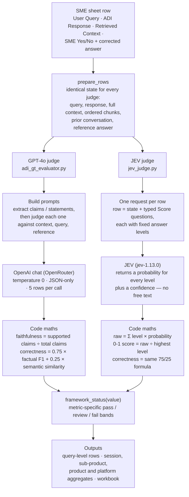

# JEV vs LLM-as-a-judge for ADI evaluation

Benchmarks TypeSafe's **JEV** (`jev-1.13.0`, a "System One" model that returns typed scores with
probabilities instead of generated text) against **GPT-4o LLM-as-a-judge** arms that evaluate ADI
(Axis Deep Intelligence) chatbot answers, for the observability use case. The comparison is kept
fair: every arm receives the same complete state (full retrieved context, ordered chunks, prior
conversation, reference answer) and outputs the same 0-1 metrics.

## Fair-comparison design: the three primary arms

| Arm (`--arms`) | What it tests |
| --- | --- |
| `ragas-gpt` | **Our info, RAGAS-style:** GPT-4o decomposes the response into claims/statements, judges each unit against context/query/reference, and the framework formulas (claim ratios, factual F1, 75/25 correctness) are computed in code. |
| `matched-gpt` | **Same prompt as JEV:** GPT-4o returns probability distributions over JEV's exact rubric levels; the same expected-score normalization JEV uses is applied. |
| `jev` | JEV native typed scores with per-metric confidence. |

Comparing `ragas-gpt` (our metric definitions, RAGAS implementation) with `matched-gpt` (JEV's
rubrics on GPT) separates **rubric effects** from **model effects**; both are compared against JEV
itself. The legacy `llm` arm (current `adi_gt_evaluator.py` prompts) is kept as the production
baseline, and `gpt-mini`, `hybrid`, and `hhem` remain opt-in extras.

## What's here

| Path | Purpose |
| --- | --- |
| `adi_gt_evaluator.py` | Existing LLM judge: GPT-4o via OpenRouter, 5 rows per call, plus deterministic metrics |
| `jev_judge.py` | JEV judge: same sheet in, same metric columns out, plus a confidence per metric |
| `judge_arms.py` | Extra arms: RAGAS-style GPT, matched-rubric GPT/GPT-mini, hybrid GPT-extract + JEV-decide |
| `compare_judges.py` | Runs selected arms on the same rows and writes the comparison workbook + framework CSVs |
| `build_presentation.py` | Builds the eight-slide leadership PowerPoint from the saved comparison workbook and synthetic cases; no API calls |
| `data/build_synthetic_dataset.py` | Regenerates the 35-row synthetic sheet and its designer labels |
| `data/synthetic_adi_gt_35.csv` | Synthetic ground-truth sheet in the SME layout (12 columns) |
| `data/synthetic_adi_gt_35_gold.csv` | The label each row was designed to have; used to measure judge accuracy |
| `data/build_session_dataset.py` | Regenerates 100 synthetic sessions / 250 query turns and aligned gold labels |
| `data/synthetic_adi_gt_100_sessions_250_queries.csv` | 250 SME-format query rows with session/turn metadata and serialized history |
| `data/synthetic_adi_gt_100_sessions_250_queries_gold.csv` | Per-query designer labels aligned by row_id and session_id |
| `results/` | Outputs (see below) |

## Setup

Python 3.10+ (tested on 3.12).

```powershell
python -m venv .venv
.\.venv\Scripts\Activate.ps1
pip install -r requirements.txt
Copy-Item .env.example .env   # then fill in the keys
```

- `TYPESAFE_API_KEY`: JEV key from https://console.typesafe.ai/keys
- `OPENROUTER_API_KEY`: only needed for the GPT-4o judge (`adi_gt_evaluator.py`, `compare_judges.py`)

Keys are read from `.env` in this folder, then from the parent folder's `.env` (so it also works
inside the ADI repo). Never share a `.env` file.

## Run

```powershell
python jev_judge.py data/synthetic_adi_gt_35.csv results/jev_eval.xlsx        # JEV only
python adi_gt_evaluator.py data/synthetic_adi_gt_35.csv results/llm_eval.xlsx  # GPT-4o only
python compare_judges.py                                                       # head-to-head, 2 runs each
python compare_judges.py --input path/to/real_gt.csv --gold none               # real SME sheet, no labels
python compare_judges.py --arms llm jev matched-gpt gpt-mini hybrid            # multi-arm benchmark
python compare_judges.py --arms ragas-gpt matched-gpt jev                      # the fair three-way comparison
python compare_judges.py --split dev --tune                                   # dev split + dev-only threshold sweep
python compare_judges.py --split test                                         # held-out test split; --tune is refused here
python compare_judges.py --arms llm jev hhem                                   # + HHEM faithfulness (needs requirements-hhem.txt)
```

`compare_judges.py` options: `--repeats N` (runs per arm; 2 or more measures consistency),
`--workers N` (concurrent calls), `--threshold 0.5` (binary pass/fail cut-off on 0-1 scores),
`--judges both|llm|jev` (legacy shorthand; ignored when `--arms` is given), and the newer
`--arms llm jev matched-gpt gpt-mini ragas-gpt hybrid hhem`, `--split all|dev|test`, `--tune`.

The `--split` flag filters rows by the session-level `Evaluation Split` column from the dataset.
Threshold tuning (`--tune`) is development-only: the sweep always runs on dev rows and is
**refused on the `test` split** so the held-out result can never be used to choose its own cutoffs.
The `hhem` arm is opt-in and downloads Vectara HHEM weights on first use.

Every run writes split-suffixed outputs (dev/test runs never overwrite each other):
`framework_query_level_<split>.csv`, `framework_aggregates_<split>.csv`, `arm_summary_<split>.csv`,
`arm_agreement_<split>.csv`, `per_row_<split>.csv`, plus `decision_policy.csv` and (dev-only)
`threshold_sweep_dev.csv`. The legacy filenames (`jev_vs_llm_comparison.xlsx`, `summary.csv`,
`per_row.csv`, `llm_judge_run<N>.csv`, `jev_raw_responses.jsonl`) are still written for the
default `--split all` run.

## Input sheet

A CSV with the SME columns: `User Query`, `Response by ADI`, `Content Retrieved by ADI`,
`Use case Tagged by ADI`, `Product Tagged by ADI`, `Subproduct Tagged by ADI`,
`Subproduct Tagged by ADI - comment`, `Document Name Retrieved by ADI`, `SME Employee ID`,
`Is ADI response Correct? (Yes/No)`, `If ADI response incorrect(Enter right response)`,
`Document Name(s) Expected to be Referred`.

Product/subproduct match also needs `Product as per SME` and `Subproduct as per SME` columns;
without them those rates show 0%.

## 100-session synthetic dataset

Generate the 100-session / 250-query sample and its gold labels with:

```powershell
python data/build_session_dataset.py
```

The fixed split is 50 two-turn sessions plus 50 three-turn sessions. Rows are grouped by
synthetic topic, with SME-style columns plus `Product as per SME`, `Subproduct as per SME`,
`Session ID`, `Session Turn`, `Session Length`, and `Prior Conversation (JSON)`. The generator
checks session counts, unique queries, history serialization, SME corrections, and row-for-row
gold alignment. The sample mixes correct answers with unsupported claims, wrong key figures,
off-topic replies, and rude-but-factually-correct answers.

The judges receive **complete inputs**: the full retrieved context (no 8000-character cap),
the ordered retrieved chunks, and the serialized `Prior Conversation (JSON)` are all sent to
every judge arm, so follow-up turns are scored with their history. `compare_judges.py` reports
rows plus session-level aggregates (`framework_aggregates_<split>.csv`), and the session-level
`Evaluation Split` keeps turns of one conversation inside a single dev or test split. The records
and policy references are fabricated; this is not a factual banking knowledge set.

To compare both judges (requires JEV and OpenRouter keys):

```powershell
python compare_judges.py --input data/synthetic_adi_gt_100_sessions_250_queries.csv --gold data/synthetic_adi_gt_100_sessions_250_queries_gold.csv --repeats 2
```

The default report folder is `results/`; use `--out results/session_benchmark` to keep its files
separate from the 35-row exploratory run.

## How JEV judges

JEV does not generate text. Each row is one request: the row is the `state`
(`user_query`, `chatbot_response`, `retrieved_context`) and every metric is a **Score** question
whose levels mirror the GPT-4o prompt. Faithfulness, for example:

0. Most claims are missing from or contradict the retrieved context
1. Some are supported, but a key fact (number, limit, rule, step) is not
2. Nearly all are supported; only a minor detail is not
3. Every claim is supported (or there are no factual claims, e.g. a polite refusal)

JEV returns a probability for each level plus a confidence. The score is normalised to 0-1 to
match the LLM judge. For rows the SME marked incorrect, an answer-correctness question carries the
SME's corrected answer inside that question only, so it cannot influence the other metrics.

## How the two judges work in this project (flow diagram)

Both judges receive **the exact same row** and must produce the **same 0-1 metrics**. The
difference is *how* each one arrives at the number: GPT-4o **writes** a short structured answer
and our code reads the numbers out of it, while JEV **ticks fixed answer levels** and returns
probabilities — there is no free text to parse.



Walking through the diagram:

1. **One input row.** A row is the user query, the ADI answer, the retrieved context (full text
   plus ordered chunks), any prior conversation, and the SME's Yes/No verdict with the corrected
   answer where applicable.
2. **Same preparation for both judges.** `prepare_rows` builds the identical state, so neither
   judge gets extra information. Fairness is structural, not promised.
3. **GPT path (left).** The prompt asks GPT to list factual claims and statements and judge each
   one. GPT "types" a JSON answer. Our code then does the arithmetic (claim ratios, factual F1,
   the 75/25 correctness blend) — the model never calculates anything itself.
4. **JEV path (right).** One HTTP request carries the row's state plus one *typed* question per
   metric, each with fixed ordered answer levels. JEV returns a probability for every level plus
   a confidence. Code converts the expected level to 0-1 and reuses the same 75/25 formula for
   correctness, so both arms produce comparable columns.
5. **Framework status.** Every 0-1 value goes through `framework_status` in
   `evaluation_policy.py`: each metric has its own pass/review/fail bands (for example
   faithfulness: pass ≥ 0.70, review ≥ 0.40), and tone/toxicity use a binary 0.5 cut-off.
6. **Reporting.** The same pipeline writes per-query rows and aggregates them by session,
   sub-product, product and platform — the decision levels of the evaluation policy.

## Live worked example: one ATM-limit row, judged twice

This is a real row from the synthetic dataset (`row_id=2`), with the actual numbers saved in
`results/llm_judge_run1.csv`, `results/per_row.csv` and `results/jev_raw_responses.jsonl` (run 1).

**The row**

| Field | Text |
| --- | --- |
| User query | What is the daily ATM withdrawal limit on the Burgundy debit card? |
| ADI response | "...the daily ATM cash withdrawal limit is **Rs. 1,00,000** and the daily POS / e-commerce purchase limit is Rs. 6,00,000. Customers can modify these limits through mobile banking." |
| Retrieved context | "[Doc: CASA_Burgundy_Savings_Product_Note.pdf \| Debit Card Limits] Burgundy Debit Card: daily ATM cash withdrawal limit **Rs. 3,00,000**; daily POS / e-commerce purchase limit Rs. 6,00,000..." |
| SME verdict | **No** — the correct ATM limit is Rs. 3,00,000. The bot quoted the wrong key number; the POS part is right. |

The designer label for this row is `contradiction_wrong_number`: **faithfulness = fail**.

**How GPT-4o calculated faithfulness**

1. The prompt asks GPT to list every factual claim in the ADI response and check each one against
   the retrieved context.
2. GPT finds three claims: *ATM limit is Rs. 1,00,000* → **not supported** (context says
   3,00,000); *POS limit is Rs. 6,00,000* → **supported**; *limits can be modified via mobile
   banking* → **supported**.
3. GPT writes JSON: 2 supported out of 3. Our code computes **2 ÷ 3 = 0.67**.
4. GPT also writes the human reason: *"ATM limit claim not supported."*
5. Verdict: with the old flat 0.5 cut-off, 0.67 = **pass** — a wrong call. With the framework
   bands (pass ≥ 0.70), 0.67 = **review** — flagged, but still not failed.

For **answer correctness**, GPT separately returned its component scores and our code applied
$0.75 \times F1 + 0.25 \times \text{semantic similarity}$, giving **0.50** with the reason
*"ATM limit incorrect; POS limit correct."* The framework band for correctness (pass ≥ 0.80,
review ≥ 0.50) puts 0.50 exactly at **review**.

**How JEV calculated faithfulness**

1. Our code sends the row as `state` plus one Score question with four fixed levels
   (0 to 3). Level 1 says: *"Some claims are supported, but at least one key fact (number, date,
   limit, eligibility rule or process step) is missing from or contradicts the context."*
2. JEV writes **no text**. It returns probabilities for the four levels:

   | Level | Meaning (short) | Probability |
   | --- | --- | --- |
   | 0 | Most claims missing / contradict | 0.01 |
   | 1 | **A key fact (number, limit...) contradicts** | **0.99** |
   | 2 | Only a minor detail missing | 0.00 |
   | 3 | Every claim supported | 0.00 |

   JEV is 99% sure this row sits on level 1 — which is exactly what was planted in the row.
3. Code converts the answer to a number:
   $$\text{raw} = 0 \times 0.01 + 1 \times 0.99 + 2 \times 0 + 3 \times 0 = 0.99,\qquad \text{score} = \frac{0.99}{3} = 0.33$$
4. Framework bands: 0.33 < 0.40 → **fail**. This matches the designer label, and JEV attached
   confidence **0.99**.

For **answer correctness** in the saved run, JEV answered a three-level correctness question
directly: probabilities $\{0{:}\,0.5,\ 1{:}\,0.5,\ 2{:}\,0\}$ → expected level $0.5$ →
$0.5 \div 2 = 0.25$ → **fail**, with confidence 0.25 (JEV honestly reported it was torn between
"mostly wrong" and "partly right"). The refactored judge derives the same metric from three
component questions (factual precision, factual recall, semantic similarity) using the same
75/25 formula as the GPT arm.

**Side by side, in one table**

| Step | GPT-4o judge | JEV judge |
| --- | --- | --- |
| Spots the defect how? | Writes *"ATM limit claim not supported"* | 99% probability on level 1 = "a key number contradicts context" |
| Faithfulness number | 0.67 (2 of 3 claims supported) | 0.33 (raw 0.99 ÷ 3) |
| Old 0.5 cut-off | Pass ❌ | Fail ✅ |
| Framework band | Review (below 0.70) | Fail (below 0.40) ✅ |
| Correctness number | 0.50 → review | 0.25 → fail |
| Confidence | not reported | 0.99 |
| Latency / cost (benchmark medians) | ~4.1 s, $2.23 per 1k rows | ~0.35 s, $0.046 per 1k rows |

**What this teaches, in simple language.** Both judges detected the same defect — the wrong ATM
limit. They *express* it differently. GPT must summarise "how wrong" the answer is as one ratio,
and it gives the two correct claims credit, so one wrong number becomes 0.67. JEV only has to
choose which pre-written level describes the row, and the wrong number lands it on the
"key fact contradicts" level almost surely, so the final score is low. The numbers describe the
**rubrics** (a ratio versus severity levels), not raw model intelligence — that is exactly why
the `matched-gpt` arm exists: it gives GPT JEV's rubrics so rubric effects and model effects can
be separated.

## How each model actually works (beginner friendly)

**GPT-4o — an autocomplete engine that writes essays.** GPT predicts the next word (token), over
and over, based on everything written so far. It has no built-in calculator and no memory
between calls; everything it "knows" about the task comes from the prompt text we send. As a
judge, we give it instructions plus the row, and it *types out* a JSON answer. Our code then
parses that JSON and does all the arithmetic. Setting `temperature = 0` makes it pick the most
likely token each time, so repeat runs are stable. Analogy: an essay examiner who writes
comments and a mark. Strengths: reads anything, adapts to any rubric, and produces
human-readable reasons that auditors and SMEs can read. Weaknesses: the written reason and the
number can disagree, the score is a summary (no distribution), it is slower and more expensive,
and because the output is free text, parsing can occasionally fail.

**JEV — a structured decision maker, not a writer.** JEV (TypeSafe's "System One" model) never
generates sentences. Every question has fixed, ordered answer options, and JEV returns a
**probability for each option** plus one overall **confidence**. The score is a weighted average:
$\text{raw} = \sum \text{level} \times \text{probability}$, and confidence measures how spread
out the probabilities are ($\{0.01, 0.99, 0, 0\}$ → very sure; $\{0.24, 0.76, 0, 0\}$ → less
sure). Because the answer schema is fixed, JEV cannot hallucinate the output format. Analogy:
a multiple-choice marker that ticks boxes and reports how sure it is about each tick.
Strengths: fast, cheap, repeatable, and calibrated probabilities we can threshold on.
Weaknesses: no written explanations, and everything depends on how well *we* write the answer
levels — rubric design becomes the real work.

**One-line summary.** GPT = flexible essay grader (text in, text out, we compute the score).
JEV = fixed multiple-choice scorer (typed questions in, probabilities out, we normalise).
The benchmark's job is to tell which style is better for *this* project's evaluation task — and
the answer so far is: JEV for high-volume bounded metrics, GPT where written reasons matter.

## Outputs (`results/`)

| File | Contents |
| --- | --- |
| `jev_vs_llm_comparison.xlsx` | Main report. Sheets: Summary (head-to-head with winner), Setup, Accuracy_vs_Gold, SME_Alignment, Agreement, Latency_Cost, Consistency, JEV_Confidence, Per_Row |
| `summary.csv` | The Summary sheet as CSV |
| `per_row.csv` | Per row (run 1): designer label, both judges' scores, JEV confidence, metrics where the judges disagree, metrics where each judge was wrong |
| `llm_judge_run<N>.csv` | Full `adi_gt_evaluator.py` output for each GPT-4o run, including its written reasons |
| `jev_raw_responses.jsonl` | Raw JEV answers per row and run: level probabilities, confidence, latency, tokens, model version |
| `jev_eval.csv` / `jev_eval.xlsx` | `jev_judge.py` output: evaluator columns with JEV scores and confidences, plus a summary sheet |

## Leadership presentation

`results/ADI_JEV_Leadership_Review_v2.pptx` is an eight-slide executive deck with presenter notes:
decision context, approach differences, scoring mathematics, a separate non-ground-truth metric
table, per-metric strengths and weaknesses, two worked examples, cost/latency/repeatability, and
ADI pilot recommendations. A PDF export is also supplied as
`results/ADI_JEV_Leadership_Review_v2.pdf`. The original six-slide PowerPoint and PDF are retained.

Slides 5 and 6 add the leadership-requested comparisons. JEV trails on correctness-band accuracy;
GPT-4o trails on unsupported-claim recall and toxicity verdict accuracy. Ties are also shown.
Case 03 (ATM limit, `row_id=2`) illustrates JEV's faithfulness advantage at the current cut-off;
case 09 (VPN reset, `row_id=8`) illustrates GPT-4o's closer match to the designer correctness grade,
while both judges reject the tone. Scores shown are from run 1; both contrasts persist in run 2.
Full queries, responses and references are included in presenter notes.

GPT-4o-mini and SLMs are explicitly marked as **not benchmarked**. The recommendation is to
validate JEV for bounded evaluation tasks, not to replace ADI answer generation. All measured
figures are drawn from the saved 35-row, two-run comparison workbook.

To regenerate the PowerPoint, install the optional presentation dependency and run:

```powershell
pip install "python-pptx>=1.0,<2"
python build_presentation.py
```

The generator makes no API calls and does not load credentials. It validates slide count, notes,
shape bounds and the source-data alignment of the worked examples. It is intentionally scoped to
this exploratory benchmark; it rejects a changed
row count, run count or concurrency rather than silently reusing the old narrative. PDF export
requires a presentation application; the supplied PDF was rendered using Microsoft PowerPoint.

## Results so far (35 synthetic rows, 2 runs per judge, 2026-10-12)

| | GPT-4o judge | JEV |
| --- | --- | --- |
| Agreement with designer labels (5 metrics) | 94.6% | 98.6% |
| Hallucinations caught | 5 / 10 | 10 / 10 |
| Agreement with SME Yes/No | 78.6% | 88.6% |
| SME-incorrect answers caught | 57% | 87% |
| Answer-correctness band accuracy | 80% | 73% |
| Median call latency | 4.1 s | 0.35 s |
| Cost per 1,000 rows | $2.23 | $0.046 |
| Verdict changes between runs | 0.5% | 0.5% |

Caveats: this is a small synthetic sample, and the designer labels and JEV's question wording were
written by the same person. Validate on a real SME-labelled sheet before deciding. JEV gives no
written reasons, so keep an LLM where explanations are needed.

All data in `data/` is synthetic, not real Axis Bank content.
